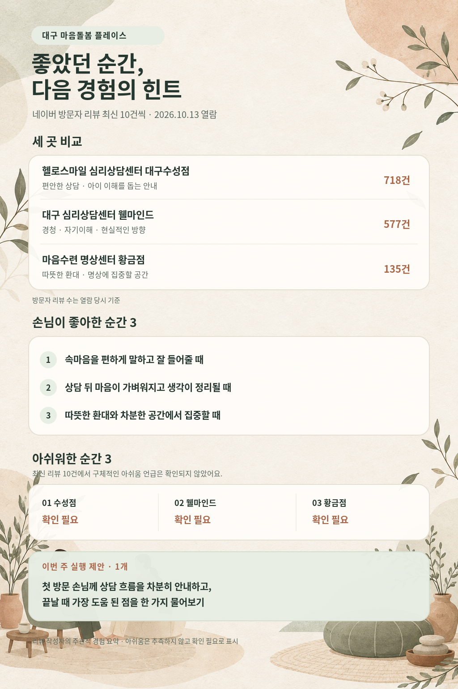

# 대구 명상·심리상담 플레이스 방문자 리뷰 정리

**열람일:** 2026년 10월 13일(KST)  
**근거 범위:** 각 네이버 플레이스 방문자 리뷰 최신순 10건. 리뷰 작성자 이름은 기록하지 않았습니다.  
**표기 원칙:** 아쉬움이 확인되지 않은 경우 추측하지 않고 「확인 필요」로 표시했습니다.

## 헬로스마일 심리상담센터 대구수성점

출처: [네이버 플레이스 방문자 리뷰](https://m.place.naver.com/place/1034501721/review/visitor) · 방문자 리뷰 718건(열람 당시)

| 구분 | 리뷰에서 확인한 내용 |
|---|---|
| 칭찬 1 | 차분하고 편안한 분위기에서 상담받고 조언을 들을 수 있었다는 평가가 있습니다. |
| 칭찬 2 | 상담 후 마음이 가벼워지거나 고민을 이야기해 답답함이 풀렸다는 평가가 있습니다. |
| 칭찬 3 | 아이의 기질·행동을 이해하고 부모가 도울 방법을 안내받아 유익했다는 평가가 있습니다. |
| 아쉬움 1 | 확인 필요 — 열람한 최신 10건에서 구체적인 아쉬움 언급을 확인하지 못했습니다. |
| 아쉬움 2 | 확인 필요 — 열람한 최신 10건에서 구체적인 아쉬움 언급을 확인하지 못했습니다. |
| 아쉬움 3 | 확인 필요 — 열람한 최신 10건에서 구체적인 아쉬움 언급을 확인하지 못했습니다. |

## 대구 심리상담센터 웰마인드

출처: [네이버 플레이스 방문자 리뷰](https://m.place.naver.com/place/1281702120/review/visitor) · 방문자 리뷰 577건(열람 당시)

| 구분 | 리뷰에서 확인한 내용 |
|---|---|
| 칭찬 1 | 편하게 속마음을 말할 수 있고 이야기를 잘 들어준다는 평가가 있습니다. |
| 칭찬 2 | 자신과 감정을 돌아보고 생각을 정리하는 데 도움이 됐다는 평가가 있습니다. |
| 칭찬 3 | 부부·개인 상담에서 상황을 이해하고 현실적인 방향을 안내받았다는 평가가 있습니다. |
| 아쉬움 1 | 확인 필요 — 열람한 최신 10건에서 구체적인 아쉬움 언급을 확인하지 못했습니다. |
| 아쉬움 2 | 확인 필요 — 열람한 최신 10건에서 구체적인 아쉬움 언급을 확인하지 못했습니다. |
| 아쉬움 3 | 확인 필요 — 열람한 최신 10건에서 구체적인 아쉬움 언급을 확인하지 못했습니다. |

## 마음수련 명상센터 황금점

출처: [네이버 플레이스 방문자 리뷰](https://m.place.naver.com/place/35316542/review/visitor) · 방문자 리뷰 135건(열람 당시)

| 구분 | 리뷰에서 확인한 내용 |
|---|---|
| 칭찬 1 | 밝고 따뜻하게 맞아주며 친절하게 안내한다는 평가가 있습니다. |
| 칭찬 2 | 편안하고 조용한 공간, 깨끗한 시설에서 명상에 집중하기 좋았다는 평가가 있습니다. |
| 칭찬 3 | 개인별 안내와 명상으로 스트레스 해소나 마음의 안정에 도움이 됐다는 평가가 있습니다. |
| 아쉬움 1 | 확인 필요 — 열람한 최신 10건에서 구체적인 아쉬움 언급을 확인하지 못했습니다. |
| 아쉬움 2 | 확인 필요 — 열람한 최신 10건에서 구체적인 아쉬움 언급을 확인하지 못했습니다. |
| 아쉬움 3 | 확인 필요 — 열람한 최신 10건에서 구체적인 아쉬움 언급을 확인하지 못했습니다. |

> 이 정리는 열람한 최신 리뷰의 주관적 경험을 요약한 것입니다. 확인하지 못한 불만이나 서비스 품질을 추정하지 않았습니다.

## 포스터와 이번 주 실행 제안

**이번 주 실행 제안:** 첫 방문 손님께 상담 흐름을 차분히 안내하고, 끝날 때 가장 도움 된 점을 한 가지 물어보기. 리뷰에서 반복된 편안한 안내와 경청 경험을 바탕으로 한 실행 제안입니다.

포스터는 최신 방문자 리뷰 10건에서 확인된 칭찬과 방문자 리뷰 수를 담았습니다. 아쉬움은 구체적 언급을 찾지 못해 장소별로 「확인 필요」라고 표시했습니다.

포스터 검수: 세 장소명과 방문자 리뷰 수, 칭찬 요약, 「확인 필요」 표기, 이번 주 실행 제안이 이 문서와 일치하는지 대조했습니다.
